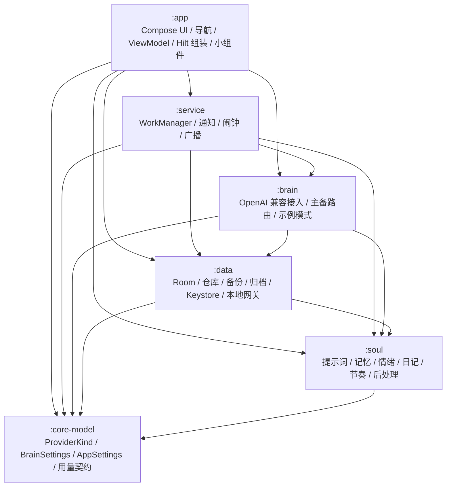
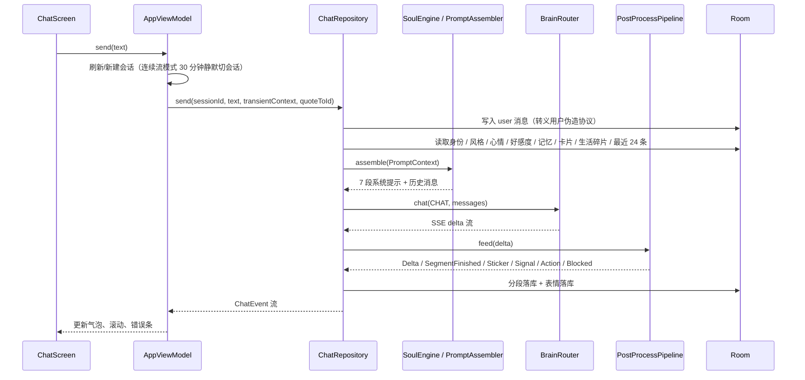

# 架构说明（ARCHITECTURE）

小鱼采用 6 模块分层：纯 JVM 的「灵魂」与「契约」在内层，Android 数据 / 模型 / 后台能力在中间，Compose UI 在最外层。核心目标是把**人格、记忆、情绪**从 Android 框架里剥离出来，让它们可以脱离设备单元测试，并保证 UI 不直接触碰网络与数据库。

## 1. 模块依赖



| 模块 | 关键内容 |
| --- | --- |
| `:soul` | `SoulEngine`、`PromptAssembler`、`PromptLibrary`、`PromptTemplates`、`MemoryRecall`、`ForgettingCurve`、`PromotionRule`、`DiaryPlanner`、`ReplyPacer`、`PostProcessPipeline`、`XyTokenParser`、`TokenEstimator` |
| `:core-model` | `ProviderKind`（4 种）、`ProviderConfig`、`BrainSettings`、`AppSettings`、`CostGuardSettings`、`ThemeMode` / `BubbleStyle` / `ChatMode` / `CompanionStyle` |
| `:data` | `XiaoyuDatabase`（17 表 / v6）、`ChatRepository`、`MemoryRepository`、`SoulStateRepository`、`StickerRepository`、`PersonaRepository`、`BackupRepository`、`MarkdownExporter`、`StickerPackArchive`、`PersonaPackArchive`、`SecretStore`、`AppLockManager`、`LocalAiRepository`、`DiagnosticsRepository` |
| `:brain` | `BrainRouter`、OpenAI 兼容 provider、SSE 流解析、主备降级、示例模式、用量计费 |
| `:service` | 9 个 Worker、`WorkScheduler`、`Notifier`（4 个通知渠道）、`AlarmReceiver`、`BootReceiver`、`NotificationReplyReceiver` |
| `:app` | 12 个页面、`AppViewModel`、`XiaoyuRoot` 导航、Hilt 模块、Glance 桌面小组件、启动自检与提示词落盘 |

## 2. 从一条消息到一句回复



### 2.1 逐步说明

1. **入口与并发保护**：`AppViewModel.send` 先取消上一轮生成，用 `generationSerial` 丢弃过期回调；连续流模式下每轮调用 `ensureSession()`，30 分钟未说话则幕后新建会话，界面不中断。
2. **写入用户消息**：`ChatRepository.replyFlow` 用 `XyTokenParser.escapeUserText` 转义用户输入中的 `[xy:*]`，避免伪造情绪、表情或动作协议；同时自动生成会话标题。
3. **显式指令**：识别「记住……」与「写日记」等用户命令，转成额外指令；「翻旧账」带来的旧对话作为**仅本轮**临时指令，不进入记忆系统。
4. **上下文装载**：当前身份与风格、当日心情与精力、好感度、按当前输入召回的 6 条短期记忆、长期卡片、3 条新鲜生活碎片、最近 24 条消息、最多 40 个表情目录。
5. **节奏控制**：开启沉浸模式时，`ReplyPacer` 先发出 `Typing(delayMs)` 让 UI 显示「正在输入」；深夜低精力可能直接回一句「困了」，跳过模型请求。未开启时 `Typing(0)` 立即请求。
6. **提示词装配**：`SoulEngine.assemble` 调 `PromptAssembler`，把可变上下文压缩进约 800 token 的预算。稳定内容在前以利用前缀缓存，最多 7 段：身份 → 长期卡片 → 风格 → 表情目录 → 心情/精力/好感 → 生活碎片 → 短期记忆（含本轮特别说明）。超预算时依次裁短期记忆、生活碎片、长期卡片。
7. **模型路由**：`BrainRouter.chat(BrainRole.CHAT, ...)` 优先聊天主模型；主模型失败且没有可见输出时切备用模型；两者都未配置则进入示例模式。
8. **流式后处理**：`PostProcessPipeline` 边收边解析，剥离协议 token，识别分段、表情、情绪副信号、动作描写、AI 腔软提醒与禁词。命中 HARD / SAFETY 拦截时清空本轮、强化「你是真实的人」后重试 1 次。
9. **落库顺序**：文字分段先落库，再落该段的表情，保证「先说话、后甩表情」；表情有冷却与单轮数量限制。
10. **收尾**：消耗 1 点精力，更新会话时间；成功则把用户消息标记为已发送，失败则标记失败并保留已生成的部分文本，供「继续」或重试。
11. **诊断与计费**：每次请求记录 provider、模型、提示词、原始输出、耗时、token、事件摘要，诊断页保留最近 50 次；用量按天聚合保留 35 天。
12. **异步记忆**：切换 / 离开会话时通过 `ExtractionScheduler` 入队 `ExtractionWorker`，用 `BrainRole.EXTRACT` 提炼短期记忆。

## 3. 记忆、情绪与关系的数据流

### 3.1 三级记忆

```text
会话消息
  └─(会话结束 / 切换)─> ExtractionWorker ─> memories（短期碎片，tier=SHORT）
        ├─(每轮按相关度召回 6 条)─> 提示词「记忆碎片」段，并 boost 强度 / reviewCount
        ├─(每晚清算)─> 遗忘曲线衰减 ─> strength 过低进入回收站 ─> 30 天后物理删除 / 期间可恢复
        └─(每晚晋升)─> 同一事实出现 3 次以上 ─> promote_memories 合并 ─> fact_cards（长期卡片）
```

- `memories` 只影响记忆表，**绝不删除 `messages`**。
- 长期卡片只做过期检查：过期内容改写为「曾经……」，不会自动进回收站；用户可在「记忆」页手动删除。
- 「记住……」走显式指令，直接写入 `fact_cards`，跳过短期碎片；失败时由 `ExplicitMemoryWorker` 指数退避重试。
- 可选的本地向量召回：`embeddings` 表 + `VectorRetriever`，没有向量模型或没有索引时自动降级为关键词 / 时间 / 强度召回。

### 3.2 情绪与精力

| 来源 | 变化 |
| --- | --- |
| 每轮用户发言 | 精力 -1（`drainEnergy(1)`） |
| 模型情绪副信号 `joy/excited/love` | 心情 +4、精力 +1 |
| `sad/hurt` | 心情 -4、精力 -1 |
| `angry` | 心情 -3 |
| `shy/tease` | 心情 +2 |
| `tired` | 心情 -1、精力 -2 |
| 对她比心 | 心情 +2、好感 +1，25% 概率回一个表情（本地随机，不请求模型） |

- 每天首次进入时 `ensureTodayMood()` 建立当日心情行，精力随夜间清算恢复。
- 深夜 + 低精力会影响回复节奏，甚至触发「困了」的本地短路。
- `mood_states` 保存每日快照，关系页与提示词都从这里取值。

### 3.3 好感度与关系

- `favorability` 保存当前值、等级与事件历史；等级由 `FavorabilityLevel.of()` 计算。
- 事件来源：戳一戳、表情回应、读日记、主动消息等，写入 `reason` 便于关系页展示。
- 好感度影响：称呼与亲密程度、主动消息频率、加密日记是否可分享（`secretShareable()` 要求达到 `BELOVED`）。
- `life_fragments` 由 `LifeWorker` 定期生成，聊天只取最新 3 条「新鲜」碎片，避免一次性倒出全部生活细节。

## 4. Room 表清单（schema v6）

| 表 | 作用 |
| --- | --- |
| `sessions` | 会话：标题、身份/风格、模式、置顶、摘要、提炼状态、时间 |
| `messages` | 消息：角色、类型（文字/表情/系统）、内容、引用、版本组、状态、表情回应 |
| `message_fts` | 消息全文索引（FTS4），供搜索 |
| `sticker_packs` | 表情包元数据：内置/导入、作者、封面、许可证 |
| `stickers` | 单个表情：文件 URI / 内置资源、标签、尺寸、使用次数 |
| `identities` | 人格身份：名字、称呼、签名、核心设定、头像 |
| `styles` | 表达风格：名称、描述、示例、语气参数 |
| `memories` | 短期记忆：层级、类型、标签、重要性、强度、复习次数、回收站时间、晋升卡片 |
| `fact_cards` | 长期事实卡：分类、内容、标签、强度、来源、过期时间、来源记忆 |
| `diaries` | 日记：日期、内容、心情、是否加密/已解锁、是否已读、是否已分享 |
| `mood_states` | 每日心情与精力快照 |
| `favorability` | 当前好感度与等级 |
| `life_fragments` | 她的生活碎片 |
| `settings` | 全局设置（单行 JSON，整体 AES-GCM 加密） |
| `request_snapshots` | 请求快照：用于重新生成时复现同一 prompt，诊断保留最近 50 次 |
| `drafts` | 每个身份一份未发送草稿 |
| `embeddings` | 可选的本地记忆向量 |

迁移链：`MIGRATION_1_2 → 2_3 → 3_4 → 4_5 → 5_6`，数据库文件名为 `xiaoyu.db`。

## 5. 后台任务与系统组件

| 组件 | 触发 | 作用 |
| --- | --- | --- |
| `ExtractionWorker` | 切换 / 离开会话 | 会话提炼为短期记忆；唯一任务 `extract-<sessionId>`，指数退避 10 分钟 |
| `ExplicitMemoryWorker` | 显式记忆写入失败 | 重试写入长期卡片，指数退避 15 分钟 |
| `DailyPlanWorker` | 每日 08:05（AlarmManager 主轨 + WM 副轨） | 早安、当天生活与主动消息排期 |
| `NightlyWorker` | 每日 23:50 | 日记、情绪清算、记忆衰减/回收站清理/晋升、生活碎片 |
| `LifeWorker` | 每日排期 | 生成她的生活碎片 |
| `ProactiveWorker` | 每日 1–3 个时段，按好感度决定 | 主动消息；受免打扰、通知权限、应用锁影响 |
| `BackupWorker` | 每 7 天，充电且电量不低 | 备份数据库与自定义提示词，保留最新 4 份 |
| `StickerImportWorker` | 用户导入 | 后台解压、校验、写库与可选自动打标 |
| `NotificationReplyWorker` | 通知栏 RemoteInput | 直接把回复送入当前会话 |
| `AlarmReceiver` | 精确闹钟 | 早安 / 晚安 / 主动消息到点入队，并立即重排下一次 |
| `BootReceiver` | 开机 / 应用升级 | 重建通知渠道、重排闹钟与周期任务 |

通知渠道共 4 个：主动消息（默认重要性、显示角标）、后台任务结果（低）、备份（最低）、系统提醒（高）。应用锁开启时，通知与锁屏只展示隐藏文案。

## 6. 依赖注入

| Hilt 模块 | 绑定 |
| --- | --- |
| `AppModule` | Room 数据库与 16 个 DAO、OkHttpClient（连接 20s / 读 180s / 写 60s）、`PromptLibrary`、`SoulEngine`、`BackupRepository` |
| `BrainModule` | 把 `:data` 定义的 `BrainGateway` 端口绑定到 `:brain` 的 `BrainRouter` |
| `SchedulerModule` | 把 `:data` 定义的 `ExtractionScheduler` 端口绑定到 `:service` 的 `WorkScheduler` |

这是典型的**端口在数据层、实现在外层**：`ChatRepository` 只依赖 `BrainGateway` 接口，不依赖 `:brain`；这样 `:data` 不需要反向依赖 `:brain`，模块图保持单向。

## 7. 提示词外置

- 内置模板位于 `app/src/main/assets/prompts/`，共 18 个 Markdown 文件；首次启动把 `PromptKeys` 对应的文件复制到应用私有目录 `files/prompts/`，已存在则不覆盖。
- 用户可以直接编辑 `files/prompts/<key>.md`。`PromptAssetSource` 的读取顺序为「私有目录 → assets」，文件空白或缺失时回退；`PromptLibrary` 最后再回退到 `DefaultTemplates` 内置兜底。
- 人格初始素材位于 `app/src/main/assets/personas/`：`identity_default.md` 与 `style_calm.md`、`style_gentle.md`、`style_playful.md`。
- `PromptAssembler` 负责最终拼装，不直接读文件；文件只提供模板文本。这样可以单测装配逻辑，也不会把文件 IO 带进 `:soul`。
- 导出人格包时，`userOverrides()` 只收集与 assets 内置内容不同的模板；未修改的模板不会写入包。

## 8. 构建约束

根目录 `assertModuleDeps` 任务在 Gradle 配置期读取各模块声明的依赖（不触发网络解析），规则如下：

| 模块 | 禁止 | 允许的项目依赖 |
| --- | --- | --- |
| `:core-model` | `android.*`、`androidx.*`、`com.android.*`；compose / room / okhttp / retrofit / work-runtime | 无 |
| `:soul` | 同上 | 仅 `:core-model` |
| `:data` | compose | `:core-model`、`:soul` |
| `:brain` | compose、room | `:core-model`、`:soul`、`:data` |
| `:service` | compose | `:core-model`、`:soul`、`:data`、`:brain` |

验证：

```bash
./gradlew assertModuleDeps
```

静态检查使用 CLI 形式的 ktlint 1.8.0 与 detekt 1.23.8；默认不阻断构建，加 `-PstrictStaticCheck` 后严格失败。源码编译目标统一为 Java 17。

## 9. 降级与失败策略

| 场景 | 行为 |
| --- | --- |
| 未配置聊天模型 | 进入示例模式，固定文案回复，不产生网络与费用 |
| 主模型失败且无可见输出 | 自动切换备用模型 |
| 主备都失败 | 保留已生成文本，标记消息失败，提供「继续 / 重试」 |
| 禁词拦截 | 丢弃本轮并强化人设后重试 1 次，仍失败则如实报错 |
| 表情编号无效 / 冷却中 | 忽略该表情，不影响文字 |
| 本地 AI 网关离线 | 生图与语音不可用，聊天、记忆、日记照常 |
| 精确闹钟无权限 | 退化为 ±10 分钟窗口调度 |
| 通知权限被拒 | 后台仍运行，但不弹主动消息通知 |
| 换机恢复备份 | 数据恢复，但 Keystore 密钥不随备份迁移，需重新填写 Key |
